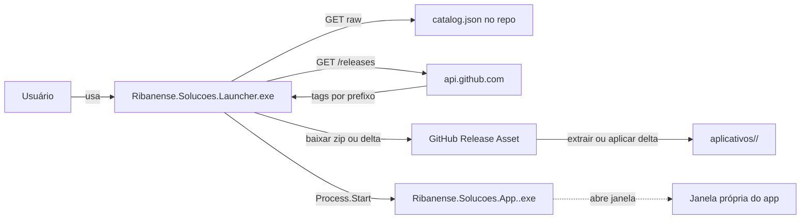

# Arquitetura

**Ribanense Soluções** é um **launcher** + **catálogo de apps modulares**, inspirado no Adobe Creative Cloud. Cada app é um `.exe` WPF independente, distribuído via GitHub Releases, com atualização granular por app e sem servidor proprietário.

## Visão geral



## Componentes

| Componente | Papel | Binário |
|------------|-------|---------|
| `Launcher` | Catálogo, instalador, atualizador, gerenciador de apps. | `Ribanense.Solucoes.Launcher.exe` |
| `PluginSDK` | Contratos entre Launcher e apps (SemVer versionado). | `Ribanense.Solucoes.PluginSDK.dll` |
| `Infrastructure` | LiteDB, logging JSON, IO. | `Ribanense.Solucoes.Infrastructure.dll` |
| `UI` | Estilos, breakpoints, base MVVM, controles reutilizáveis. | `Ribanense.Solucoes.UI.dll` |
| Apps (`aplicativos/<Nome>/`) | Cada módulo publicado no catálogo. | `Ribanense.Solucoes.App.<Nome>.exe` |

## Estrutura em disco no usuário final

```
%LOCALAPPDATA%/Programs/Ribanense Soluções/     (cópia instalada)
  Ribanense.Solucoes.Launcher.exe
  *.dll
  payload-manifest.json

%LOCALAPPDATA%/Ribanense Soluções/              (dados; também no modo avulso)
  Launcher.dat
  aplicativos/
    Winget/
      app.json
      payload-manifest.json
      Ribanense.Solucoes.App.Winget.exe
      *.dll

<pasta escolhida>/                              (cópia portátil, com portable.flag)
  Ribanense.Solucoes.Launcher.exe
  dados/
  aplicativos/
```

Dados mutáveis por app:

```
%LOCALAPPDATA%/Ribanense Solucoes/apps/<id>/
  <Nome>.dat                                   (LiteDB do app)
  cache/
  logs/
```

## Fluxo de atualização por app

1. Launcher varre `aplicativos/` para montar a lista de instalados. Projetos parceiros ([`PARCEIROS.md`](PARCEIROS.md)) também são procurados no registro e nas pastas declaradas.
2. Para cada app: consulta `GET /repos/{owner}/{repo}/releases`, filtra por `tag.startsWith(githubTagPrefix)`, obtém o maior SemVer.
3. Compara com a versão local (`app.json` ou, no parceiro, registro / `--version`). Se maior, badge "Atualizar".
4. Apps deste repositório: se existir uma corrente de deltas desde a versão instalada, baixa só esses arquivos; senão baixa o zip completo. Valida SHA256, monta uma pasta temporária e faz swap atômico. Detalhe em [`ATUALIZACOES_INCREMENTAIS.md`](ATUALIZACOES_INCREMENTAIS.md).
5. Se o app está em execução (mutex `Global\Ribanense.<id>`), a atualização é bloqueada com UI clara.
6. **Instalar** deixa só os arquivos. **No Windows** também cria atalho no Menu Iniciar e entrada em Aplicativos e recursos (HKCU).

O próprio launcher segue o mesmo delta. A cópia pode ser portátil (marcador `portable.flag` ao lado do `.exe`, dados em `dados/` e apps em `aplicativos/`) ou instalada em `%LOCALAPPDATA%\Programs\Ribanense Soluções`. Variáveis `RIBANENSE_*` vencem o marcador, que vence o padrão. Atualizar, instalar e abrir as pastas ficam em **Configurações**; a remoção (com opção de apagar apps e dados) fica em **Sobre**.

## Navegação do Launcher

| Item | Conteúdo |
|------|----------|
| **Meus apps** (1º) | Só os apps instalados, com abrir, atualizar e desinstalar. |
| **Catálogo** (2º) | Todos os apps publicados, com o bloco **Atualizações** no topo quando há versão nova instalada. |
| **Configurações** (3º) | Configurações do próprio launcher: atualização, forma de instalação, pastas, limpeza de dados dos apps e URL do catálogo. |
| **Sobre** (4º) | Identidade e versões, caminhos da instalação, links do projeto e desinstalação do launcher. |

## Garantias de independência

- **Launcher sem apps**: funciona; aba Catálogo mostra todos publicados, Meus apps vazio.
- **App sem Launcher**: executar o `.exe` diretamente funciona; sem `RIBANENSE_APP_DATA`, usa defaults locais em `%LOCALAPPDATA%`.
- **Nada de dependência de compilação** entre Launcher e apps. Contrato via `app.json` + CLI (`--version`, `--selfcheck`).

## Naming e ortografia

| Onde aparece | Forma |
|--------------|-------|
| UI, manifestos públicos, README, installer | **Ribanense Soluções** (com ç e õ) |
| Namespaces, pastas, tags, IDs, CLI | **Ribanense.Solucoes** (ASCII) |
| Paths runtime (Program Files, LOCALAPPDATA) | "Ribanense Soluções" (tolerado pelo Windows) |

## Onde ficam os arquivos

| Situação | Executável | Dados |
|----------|-----------|-------|
| `.exe` único, só rodando | `%LOCALAPPDATA%\Ribanense Soluções\runtime\<versão>\` (pasta extraída) | `%LOCALAPPDATA%\Ribanense Soluções\` |
| Instalado | `%LOCALAPPDATA%\Programs\Ribanense Soluções\` | `%LOCALAPPDATA%\Ribanense Soluções\` |
| Portátil | pasta escolhida, com `portable.flag` | `<pasta>\dados`, apps em `<pasta>\aplicativos` |

O `.exe` único roda a partir da extração, mas os dados continuam em `%LOCALAPPDATA%`, então nada se perde entre reexecuções.

## Documentos relacionados

- [`PLUGIN_SDK.md`](PLUGIN_SDK.md)
- [`RELEASE_PROCESS.md`](RELEASE_PROCESS.md)
- [`ATUALIZACOES_INCREMENTAIS.md`](ATUALIZACOES_INCREMENTAIS.md)
- [`PARCEIROS.md`](PARCEIROS.md)
- [`../AGENTS.md`](../AGENTS.md)
